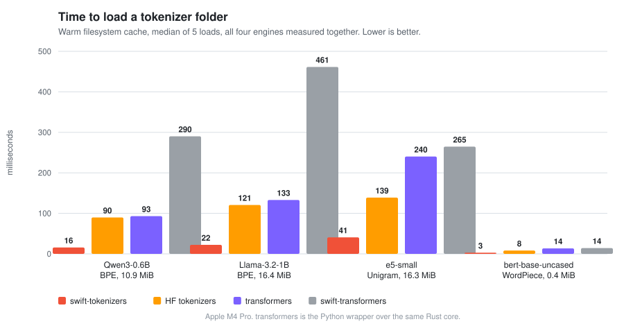

# Benchmarks

Apple M4 Pro (10 performance + 4 efficiency cores), 24 GB, macOS 26.6.2, Apple Swift 6.3.3,
release builds, Swift 6 language mode. Every performance figure below was measured in one sitting
on an idle machine, with all engines run back to back over byte-identical input.

| | |
|---|---|
| References | Hugging Face `tokenizers` 0.22.2 (Rust), `transformers` 4.57.6, `tiktoken` 0.14.0, `google/sentencepiece` @ master (C++, CMake Release), swift-transformers @ `c21fdcd` |
| Threads | one, everywhere except [Concurrent encoding](#concurrent-encoding). `RAYON_NUM_THREADS=1` and `TOKENIZERS_PARALLELISM=false` for the Rust core |
| Timing | `clock_gettime_nsec_np(CLOCK_UPTIME_RAW)` in Swift, `time.perf_counter()` in Python. Warm-up, then best of 5 to 7 passes |
| Memory | `phys_footprint` delta across the load after returning free pages to the OS, sampled the same way in Swift, C++ and Python |
| Units | `MB/s` means MiB/s (1,048,576 bytes) |
| Correctness | every number below comes from a run whose token ids were first verified against Hugging Face. See [Correctness](#correctness) |

Run to run variation is about 3% for throughput and 5% for load time. Where two runs of an engine
disagreed, the tables quote its faster run.

**Contents:** [Encode throughput](#encode-throughput) · [Multilingual text and SentencePiece](#multilingual-text-and-sentencepiece) · [Which Hugging Face call to compare against](#which-hugging-face-call-to-compare-against) · [Load time](#load-time) · [Memory](#memory) · [Decode](#decode) · [Embedding models and rerankers](#embedding-models-and-rerankers) · [Real model folders](#real-model-folders) · [Concurrent encoding](#concurrent-encoding) · [Correctness](#correctness) · [Why it is fast](#why-it-is-fast) · [Reproducing](#reproducing)

## Encode throughput

English prose through the Qwen3 byte-level BPE pipeline (`mlx-community/Qwen3-0.6B-Base-DQ5`,
151,669 tokens): added tokens, normalization, pre-tokenization, merges, post-processing.

| Input | swift-tokenizers | HF `tokenizers` | tiktoken `o200k` | tiktoken `cl100k` | swift-transformers |
|---|---:|---:|---:|---:|---:|
| 53 B × 4,000 | **126.5 MB/s** | 5.0 | 28.9 | 21.7 | 0.90 |
| 1.1 KB × 1,000 | **223.9 MB/s** | 6.4 | 49.5 | 34.0 | 0.98 |
| 11.5 KB × 100 | **236.2 MB/s** | 6.6 | 54.1 | 36.0 | 0.97 |
| 1.15 MB × 1 | **231.4 MB/s** | 5.4 | 55.6 | 36.4 | 1.00 |

On the 1.15 MB document that is **43× Hugging Face's `Tokenizer.encode`, 4.2× tiktoken `o200k`**
and **231× swift-transformers**, with identical token ids. Hugging Face's fastest entry point,
the ids-only batch call, reaches 7.2 MB/s on the same document, so the ratio against it is **32×**.
[Which call to compare against](#which-hugging-face-call-to-compare-against) sets out all three.

Short calls matter as much as bandwidth: a 53-byte query costs **0.40 µs**, against 10.1 µs for
Hugging Face and 56 µs for swift-transformers.

`tiktoken` is not the same pipeline. It runs its own regex split and merges over a different
vocabulary, with no normalizer, added tokens or post-processor. It is the fastest widely used
tokenizer, so it is the interesting bar.

## Multilingual text and SentencePiece

Google's own SentencePiece benchmark corpus: 11.2 MiB of FLORES-200 sentences in English,
Chinese, Japanese and Thai, 60,720 lines, encoded line by line. Every engine in a group reads the
same vocabulary and emits byte-identical ids on all 60,720 lines.


| Model | swift-tokenizers | SentencePiece C++ | HF `tokenizers` | swift-transformers |
|---|---:|---:|---:|---:|
| T5, Unigram, 32k | **125.9 MB/s** | 67.3 (1.87× slower) | 10.9 | 1.4 |
| Gemma 3, SentencePiece BPE, 262k | **44.5 MB/s** | 23.4 (1.90× slower) | 12.4 | 1.3 |
| Qwen 3, byte-level BPE, 152k | **64.2 MB/s** | n/a | 5.9 | 0.5 |

`tiktoken` cannot read a Hub tokenizer, so it runs its own vocabulary over the same text:
20.2 MB/s (`cl100k_base`) and 19.8 MB/s (`o200k_base`).

Unigram is the heaviest path here, a Viterbi lattice over `▁`-prefixed pieces with no byte-level
alphabet, and it is still 1.9× the C++ implementation of the same algorithm.

## Which Hugging Face call to compare against

Rust `tokenizers` has three entry points, and they do different amounts of work:

| Call | Returns | Threads |
|---|---|---|
| `Tokenizer.encode` | a full `Encoding`: ids, type ids, tokens, offsets, word ids, attention and special-token masks | one, always |
| `encode_batch` | the same, for a whole batch | rayon |
| `encode_batch_fast` | the same for a whole batch, with offset tracking skipped and every offset left at zero | rayon |

There is no way to ask it for ids alone from a single string, so a caller holding one text pays
for the whole `Encoding` every time. The tables above use that call because it is the cheapest
way each library encodes one text. The matched comparisons are here: our `encode(text:)` against
`encode_batch_fast`, and `encode(text:withOffsets:)` against `encode_batch`. Same corpus, same
vocabularies, identical token counts (T5 763,275, Gemma 3 1,989,660, Qwen 3 2,464,005).

Ids only:

| Model | ours, 1 thread | `encode_batch_fast` | ours, 8 threads | `encode_batch_fast`, 8 threads |
|---|---:|---:|---:|---:|
| T5, Unigram, 32k | **123.3 MB/s** | 14.7 | **477.9 MB/s** | 60.7 |
| Gemma 3, SentencePiece BPE, 262k | **44.8 MB/s** | 19.1 | **208.7 MB/s** | 64.1 |
| Qwen 3, byte-level BPE, 152k | **64.0 MB/s** | 6.7 | **169.1 MB/s** | 28.4 |

Ids and source offsets:

| Model | ours, 1 thread | `encode_batch` | ours, 8 threads | `encode_batch`, 8 threads |
|---|---:|---:|---:|---:|
| T5, Unigram, 32k | **18.1 MB/s** | 10.4 | **88.0 MB/s** | 46.8 |
| Gemma 3, SentencePiece BPE, 262k | **30.8 MB/s** | 11.7 | **125.3 MB/s** | 46.3 |
| Qwen 3, byte-level BPE, 152k | **35.3 MB/s** | 5.6 | **104.8 MB/s** | 25.2 |

Two things follow. Materialising the full `Encoding` costs Rust 1.2× to 1.6× on its own batch
API, for fields most callers never read. And `Tokenizer.encode` does not parallelise at all:
10.5 MB/s on one thread and 10.5 on eight for T5, 12.0 and 11.9 for Gemma 3, 5.6 and 5.6 for
Qwen 3. Rust puts its parallelism in the batch API, which needs the whole corpus in hand. Ours is
in the call itself, so threads sharing one instance scale without a batch API
(see [Concurrent encoding](#concurrent-encoding)).

Offsets are opt-in here for the same reason: a caller who wants ids should not pay for
alignment. When both are asked for, we are still 1.7× to 6.3× ahead.

## Load time



Warm filesystem cache, median of 5 loads of the same folder.

| Folder | swift-tokenizers | HF `tokenizers` | `transformers` | swift-transformers |
|---|---:|---:|---:|---:|
| Qwen3-0.6B, byte-level BPE, 10.9 MiB | **15.7 ms** | 89.9 ms | 93.1 ms | 290.2 ms |
| Llama-3.2-1B, byte-level BPE, 16.4 MiB | **22.3 ms** | 120.8 ms | 133.0 ms | 461.4 ms |
| multilingual-e5-small, Unigram 250k, 16.3 MiB | **40.7 ms** | 138.9 ms | 240.3 ms | 264.8 ms |
| bert-base-uncased, WordPiece 30k, 0.4 MiB | **2.9 ms** | 8.3 ms | 13.5 ms | 14.2 ms |

Byte-level BPE spends most of a load in the JSON parser, Unigram in the double-array trie.
Interning a published merge list means a few hundred thousand independent probes into tables
larger than the last-level cache, so the symbol lookups are resolved across cores and the table is
then filled in rank order, which keeps the result independent of how the ranks were split.

Forcing the ranks into a fixed number of chunks shows that the gain does not need many cores:

| Chunks | Llama-3.2-1B | Gemma 3, 262k | Qwen3-0.6B |
|---:|---:|---:|---:|
| 1, serial | 30.6 ms | 67.4 ms | 19.6 ms |
| 2 | 26.1 ms | 58.6 ms | 17.2 ms |
| 4 | 23.8 ms | 54.0 ms | 16.2 ms |
| default, 4 per core | **22.0 ms** | **51.2 ms** | **15.5 ms** |

Several chunks per core rather than one keeps a phone's efficiency cores from holding up an even
split.

## Memory


Footprint added by `AutoTokenizer.load`, and the live heap behind it, in a warm process that loads
several tokenizers in sequence as an app does.

| Folder | `tokenizer.json` | Live heap | Footprint |
|---|---:|---:|---:|
| Qwen3-Embedding-0.6B, byte-level BPE | 10.9 MiB | 11.1 MB | 10.3 MB |
| Qwen3-Reranker-0.6B, byte-level BPE | 10.9 MiB | 10.9 MB | 9.1 MB |
| Llama-3.2-1B-Instruct, byte-level BPE | 16.4 MiB | 13.5 MB | 13.3 MB |
| multilingual-e5-small, Unigram 250k | 16.3 MiB | 19.1 MB | 19.0 MB |
| bge-m3, Unigram 250k | 16.3 MiB | 19.1 MB | 19.0 MB |
| bge-reranker-v2-m3, Unigram 250k | 16.3 MiB | 19.1 MB | 18.5 MB |
| jina-reranker-v2-base-multilingual, Unigram 250k | 16.3 MiB | 19.1 MB | 18.5 MB |
| bert-base-uncased, WordPiece 30k | 0.4 MiB | 1.1 MB | 0.7 MB |
| nomic-embed-text-v1.5, WordPiece 30k | 0.7 MiB | 1.0 MB | 0.1 MB |

Footprint tracks live heap for every family: nothing is left behind in the allocator. The two large
structures are the packed vocabulary (token UTF-8 in one buffer, a 4-byte offset per piece, a
byte-hash index) and, for Unigram, the double-array trie of 785,408 12-byte units. The pre-token
cache reserves a 2.5 MB arena that fills lazily, and decode tables are built on first use, so a
tokenizer that only encodes never pays for them.

The trie builder needs an upper bound of tens of megabytes for its unit array while it works. It
gets that from anonymous pages the VM system zero-fills on first touch and unmaps once the trie is
trimmed to size, so the reserved slack is never written and never charged: a cold load of
multilingual-e5-small peaks at 20.4 MB instead of 51.9 MB, and T5 at 3.9 MB instead of 7.3 MB.

## Decode

| Operation | Time | Rate |
|---|---:|---:|
| Decode 30 KB, 2,540 tokens | 0.0097 ms | 1,136 MB/s |
| Streaming decode, 200 single-token steps | 0.098 ms | 0.49 µs per step |
| `convertIdToToken` walk of all 151,669 entries | 3.24 ms | 21 ns per token |

The vocabulary walk is how MLX guided generation discovers the token space, so it has to be O(1)
per id and dense. All 150k lookups cost about as much as one 30 KB encode.

## Embedding models and rerankers

Queries and RAG passages through the tokenizers of on-device embedding and reranking models.
Corpus: 16 queries (~35 B), 16 passages (~620 B), 4 long passages (~2.4 KB), 13 multilingual texts
(Thai, Devanagari, combining marks, ZWJ emoji), and a 512-passage batch (318 KB). Per-text
medians, one run of one harness. Every model was verified against Hugging Face goldens on all 68
texts before anything was timed.

| Model | Type | Query | Passage | Long passage | 512-passage batch |
|---|---|---:|---:|---:|---:|
| bge-small-en-v1.5 | WordPiece | 0.3 µs | 1.9 µs · 311 MB/s | 6.8 µs · 336 MB/s | 1.02 ms · 298 MB/s |
| all-MiniLM-L6-v2 | WordPiece | 0.3 µs | 1.9 µs · 304 MB/s | 6.8 µs · 335 MB/s | 1.03 ms · 295 MB/s |
| ms-marco-MiniLM-L-6-v2 | WordPiece | 0.3 µs | 2.0 µs · 301 MB/s | 7.0 µs · 323 MB/s | 1.02 ms · 297 MB/s |
| nomic-embed-text-v1.5 | WordPiece | 0.3 µs | 1.9 µs · 306 MB/s | 7.0 µs · 326 MB/s | 1.07 ms · 283 MB/s |
| bert-base-uncased | WordPiece | 0.3 µs | 2.1 µs · 277 MB/s | 7.7 µs · 296 MB/s | 1.01 ms · 301 MB/s |
| bge-m3 | Unigram (XLM-R) | 0.3 µs | 2.1 µs · 279 MB/s | 7.5 µs · 304 MB/s | 1.17 ms · 260 MB/s |
| multilingual-e5-small | Unigram (XLM-R) | 0.3 µs | 2.2 µs · 272 MB/s | 7.5 µs · 303 MB/s | 1.12 ms · 271 MB/s |
| bge-reranker-v2-m3 | Unigram (XLM-R) | 0.4 µs | 2.4 µs · 248 MB/s | 8.3 µs · 275 MB/s | 1.12 ms · 270 MB/s |
| jina-reranker-v2-base-multilingual | Unigram (XLM-R) | 0.4 µs | 3.1 µs · 192 MB/s | 12.0 µs · 190 MB/s | 1.68 ms · 180 MB/s |
| Qwen3-Reranker-0.6B | byte-level BPE | 0.3 µs | 2.9 µs · 206 MB/s | 10.7 µs · 212 MB/s | 1.57 ms · 193 MB/s |
| Qwen3-Embedding-0.6B | byte-level BPE | 0.3 µs | 2.9 µs · 204 MB/s | 13.1 µs · 173 MB/s | 1.56 ms · 194 MB/s |
| Llama-3.2-1B-Instruct | byte-level BPE | 0.3 µs | 2.9 µs · 205 MB/s | 10.5 µs · 216 MB/s | 1.52 ms · 199 MB/s |

A reranker scoring 100 candidates spends well under a millisecond tokenizing them. Indexing 1,000
passages with multilingual-e5-small takes about 2.2 ms.

## Real model folders

Six mlx-community folders loaded through mlx-swift-lm's `#huggingFaceTokenizerLoader()` macro and
the `MLXLMCommon.Tokenizer` bridge, which is exactly the path an app takes. Each folder is checked
against Hugging Face goldens on 301 texts for both `addSpecialTokens` values, both
`skipSpecialTokens` values, the chat template with and without tools, and a full vocabulary walk.

| Folder | Vocabulary | Load | Goldens |
|---|---:|---:|---|
| Qwen3-14B-4bit | 151,669 | 45.8 ms | exact |
| DeepSeek-R1-Distill-Qwen-14B-4bit | 151,665 | 51.3 ms | exact |
| Falcon-H1R-7B-8bit | 130,048 | 49.6 ms | exact |
| Qwen3.5-9B-8bit | 248,077 | 69.1 ms | exact |
| Muse-Glimmer-30B-4bit (o200k) | 202,048 | 96.0 ms | exact |
| gemma-4-12B-it-qat-OptiQ-4bit | 262,144 | 103.0 ms | exact |

Compiling the same harness against swift-transformers instead fails on four of the six: no BOS on
301/301 texts plus 54 decode errors and the wrong chat template for gemma-4, 45 decode errors for
Muse-Glimmer, and one encode error each for Qwen3-14B and DeepSeek-R1 on Thai combining marks.

## Concurrent encoding

The FLORES corpus split across a fixed pool of threads, one tokenizer instance shared by all of
them. `isolated` gives each worker its own instance, which removes every shared reference count
and shows the ceiling.

| Threads | 1 | 2 | 4 | 8 | 14 |
|---|---:|---:|---:|---:|---:|
| T5 Unigram, shared | 120 | 194 | 328 | 471 | 540 MB/s |
| T5 Unigram, isolated | 122 | 233 | 424 | 630 | 852 MB/s |
| T5 Unigram, SentencePiece C++ | 69 | 135 | 242 | 425 | 623 MB/s |
| Gemma 3 BPE, shared | 44 | 74 | 124 | 211 | 280 MB/s |
| Gemma 3 BPE, SentencePiece C++ | 24 | 47 | 88 | 161 | 232 MB/s |

A shared instance scales because the hot path touches no reference count on shared state: the
vocabulary, merges and symbol tables are raw buffers owned by the model, encode scratch is
thread-local, and the pre-token cache is taken with a `tryLock` so a caller that finds it busy
memoises into a private table instead of waiting. Only the 14-thread T5 case shows the remaining
contention, where SentencePiece pulls ahead of the shared instance.

## Correctness

| Check | Scope | Result |
|---|---|---|
| `DifferentialTests` | 24 tokenizer families × 301 adversarial texts, ids and decoded text vs `transformers` goldens | exact |
| `PairEncodingTests` | 8 BERT, RoBERTa, XLM-R, Qwen and T5 tokenizers × 9 sequence pairs × both special-token modes, ids and segment ids vs Rust `tokenizers` | exact |
| SentencePiece three-way | T5 and Gemma 3, all 60,720 FLORES lines, ids vs the C++ `.model` engine and vs the Rust core | 60,720/60,720 exact, both models |
| Embedding harness | 12 embedding and reranker models × 68 texts | 816/816 exact |
| Real model folders | 6 mlx-community folders × 301 texts, both special-token modes, chat templates with and without tools | exact |
| Randomised differential | 3 seeds × 400 generated texts × ~50 tokenizer folders, ids, decoded text, offsets and token strings | 0 id and 0 decode mismatches |
| Corrupt-input fuzz | 2,400 byte-mutated configurations driven through parsing, construction, encode, decode and `convertIdToToken` | builds or throws a typed error, never traps |
| Sanitizers | full suite under thread, address and undefined-behaviour sanitizers, debug and release | clean |

### Known divergences, and which side is right

Differing from `transformers` is not the same as being wrong. Every divergence the harnesses
report was traced to its source. This is the complete list.

| Divergence | Verified against | Conclusion |
|---|---|---|
| Byte-level offsets after a byte the vocabulary does not contain (Falcon) | Rust `tokenizers` directly | **Upstream bug.** In `tiiuae/falcon-7b`, `'ò'` (byte `0xF2`) is missing, so the first byte of `U+080D80` produces no token. Rust then shifts the attribution and charges the next character's first byte-token to the character that lost a byte. Our offsets stay aligned with the characters that produced each token. |
| Whisper decodes timestamp tokens as text | Rust `tokenizers` directly | **Different layer.** Rust also returns `<\|5.50\|>`, for either value of `skip_special_tokens`, because the token is not marked special. `transformers` removes them in `WhisperTokenizerFast._filter_timestamp_ids` unless `decode_with_timestamps=True`. We implement the `tokenizer.json` semantics. |
| `tokenize(text:)` returns `"<mask>"` where `transformers` returns `" <mask>"` for an `lstrip` added token | Rust `tokenizers` directly | **Both defensible, ids identical.** For `" <mask>"` Rust reports the token string `" <mask>"` and the offset `(1, 7)`, so its own two answers disagree about the space. We report the vocabulary spelling, which is what `convertIdToToken` returns and what our offsets cover. |
| Chat templates render a null as `""`, and strings inside a container without quotes | swift-jinja alone, no tokenizer involved | **Upstream swift-jinja.** Python Jinja renders `None` as `None` and uses `repr` inside containers. |
| Key order inside a tool's `parameters` | this library | **Caller's choice.** `[String: any Sendable]` is unordered, so user-named containers come out alphabetically. Pass `KeyValuePairs` or a `Jinja.Value` to fix the order. Canonical OpenAI and `get_json_schema` keys always keep their documented order. |
| A folder with both `chat_template.json` and a `chat_template` in `tokenizer_config.json` uses the former | `transformers` source | **Deliberate.** `chat_template.json` is `LEGACY_PROCESSOR_CHAT_TEMPLATE_FILE`, read by `AutoProcessor` and not by `AutoTokenizer`, and it is the template a vision model needs. swift-transformers uses the same precedence. A vision-language folder whose processor template has no tools branch therefore renders without tools; pass the other template with `ChatTemplateArgument.literal` if you need it. |
| `transformers` 5 gives different ids for Llama 1/2, XLM-R and DeepSeek-R1-Distill-Qwen | Rust `tokenizers`, `transformers` 4.57.6 and 5.20.2 | **Different layer.** `transformers` 5 rebuilds the `LlamaTokenizer` and `XLMRobertaTokenizer` pipelines instead of loading `tokenizer.json`, and loads qwen2 checkpoints that declare `LlamaTokenizerFast` as `Qwen2Tokenizer`. So `" "` becomes `▁` (29871) on Llama where Rust gives `▁▁` (259), XLM-R drops a trailing `▁`, and DeepSeek-R1-Distill-Qwen loses the BOS its `add_bos_token: true` asks for. We follow `tokenizer.json` and `tokenizer_config.json`, as the Rust core and `transformers` 4 do. Decoding does follow `transformers` 5: `clean_up_tokenization_spaces` never applies to BPE models. |

One intentional difference from upstream: added tokens are always matched against the raw text,
which is the legacy Llama-2 `normalized: true` behaviour that Hugging Face also produces.

## Why it is fast

* **One byte-level pipeline.** Added-token splitting, every normalizer and every pre-tokenizer
  operate on `UnsafeBufferPointer<UInt8>` with pooled scratch, so encoding never materializes an
  intermediate string. Normalizers report when they would leave a chunk unchanged, so ordinary
  text is not even copied. The `String` APIs are derived from the same byte implementations.
* **Regex-free pre-tokenization.** The GPT-2, Llama-3/cl100k, Qwen-2, Qwen-3.5, o200k, Falcon-H1
  and DeepSeek split patterns are hand-written linear scanners over UTF-8, fuzz-tested against
  `NSRegularExpression` for exact equivalence. Unknown patterns fall back to it.
* **SIMD byte kernels.** ASCII classification runs 16 bytes per NEON register. Swift's own `SIMD`
  comparisons lower to scalar loops, so the kernels build `0x80` lane masks from adds and XORs and
  reduce them as two 64-bit words.
* **Integer BPE and double-array tries.** BPE symbols are ids, not strings, and merges resolve
  through a flat open-addressing table keyed by `(leftId, rightId)`. Unigram runs its Viterbi
  lattice over a static double-array trie: one 12-byte unit per node, one load per input byte, no
  hashing. The same trie matches added tokens.
* **Packed vocabulary.** Tokens live in one UTF-8 buffer with an offsets table, giving O(1)
  `convertIdToToken`, behind a byte-hash index that is binary-distinct, so `"à"` and `"a\u{300}"`
  stay different tokens. Every table is sized exactly, filled once and then read through raw
  pointers.
* **No shared reference counts on the hot path.** Tables read per byte or per word are raw buffers
  owned by their model. A retain on an object every thread shares is an atomic on one cache line,
  and a handful per word was enough to make eight threads slower than one.
* **Fast configuration loading.** A purpose-built JSON parser produces `Config` trees directly
  and packs vocabularies and merges into flat page-backed buffers. In one harness run, parsing
  the 10.9 MiB Qwen3 file costs 53.8 ms through `JSONSerialization` and 30.6 ms through the
  generic `Config` path, while a complete load, parse plus every table the tokenizer needs,
  finishes in 19.6 ms. Scores are read with `serde_json`'s algorithm, so Unigram ties resolve
  exactly as they do in Rust.

## Reproducing

The in-repo suite downloads its fixtures on first run and prints the encode, decode,
vocabulary-walk and load tables:

```sh
RUN_BENCHMARKS=1 swift test -c release --filter Benchmarks
```

To compare equivalent legacy and canonical Metaspace pipelines for T5 and Mistral, run
`RUN_BENCHMARKS=1 swift test -c release --filter MetaspaceBenchmarkTests`. This suite checks
ID parity before timing IDs-only and aligned encoding of queries, passages, large documents
and multilingual text, then reverses the measurement order on its second pass.

Cross-engine numbers come from four harnesses over the same corpus files, each reporting MiB/s and
a `phys_footprint` delta around the load, so the columns are comparable: a SwiftPM executable for
this library, a C++ executable linking `libsentencepiece.a`, a Python script for the Rust core and
`tiktoken`, and a second SwiftPM executable with a path dependency on a swift-transformers
checkout. The embedding, reranker and real-folder harnesses need local model folders and an
mlx-swift-lm checkout; each verifies every text against Hugging Face goldens before timing
anything.

Measure one engine at a time. A concurrent build skews every number, and short inputs are
sensitive to CPU clock state, so each harness encodes the 1.15 MB document three times before the
first timed case.
